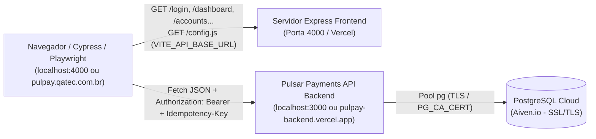

# Pulsar Payments Web Frontend (`ppp-pulpay-frontend`)

Aplicação Web (Frontend) do **Pulsar Payments**, um Hub de Pagamentos, Gestão de Carteiras e Conciliação com Webhooks desenvolvido com finalidade didática para o **Trabalho Final da Mentoria 2.0 (Turma 5) — Júlio de Lima**.

O projeto foi concebido seguindo princípios de **Design for Testability (Padrão QA 2.0)**, acessibilidade (`WCAG / a11y`), segurança client-side e experiência do usuário moderna (com **Bulma CSS v1**, barra de navegação fixa com efeito *Glassmorphism*, **Dark Theme / Light Theme** persistente e micro-interações CSS aceleradas por hardware).

---

## Sumário

1. [Stack Tecnológica](#1-stack-tecnológica)
2. [Arquitetura da Aplicação e Estrutura de Diretórios](#2-arquitetura-da-aplicação-e-estrutura-de-diretórios)
3. [Especificação de Regras de Negócio Frontend (RN-FE-01 a RN-FE-12)](#3-especificação-de-regras-de-negócio-frontend-rn-fe-01-a-rn-fe-12)
4. [Catálogo de Seletores Resilientes (`data-testid`) para Automação E2E](#4-catálogo-de-seletores-resilientes-data-testid-para-automação-e2e)
5. [Boas Práticas de Mercado, UI/UX, Acessibilidade e Segurança](#5-boas-práticas-de-mercado-uiux-acessibilidade-e-segurança)
6. [Heurísticas e Cenários de Teste E2E / QA (Mentoria 2.0)](#6-heurísticas-e-cenários-de-teste-e2e--qa-mentoria-20)
7. [Instalação, Configuração e Execução](#7-instalação-configuração-e-execução)
8. [Documentação da Wiki do GitHub (`wiki/`)](#8-documentação-da-wiki-do-github-wiki)

---

## 1. Stack Tecnológica

- **Runtime & Servidor Web:** Node.js v18+ com **Express** (`express` v4.21+) rodando na porta **`4000`** (`PORT=4000`) e ES Modules nativo (`"type": "module"`).
- **Frontend & Estilização:**
  - **HTML5 Semântico** com atributos ARIA (`role="alert"`, `role="status"`, `aria-live="polite"`, `aria-live="assertive"`) e associação explícita `<label for="...">`.
  - **Bulma CSS v1.0** servido localmente (`/vendor/bulma/bulma.min.css`) sem dependência de CDNs externas (execução 100% determinística em ambientes isolados de CI/CD).
  - **CSS3 Customizado (`public/css/styles.css`):** Sistema de *Design Tokens* (CSS Custom Properties) para suporte nativo a **Light Theme** e **Dark Theme** (`html[data-theme="dark"]`), navbar fixa no topo (`is-fixed-top`) e efeitos de hover com curva `cubic-bezier(0.22, 1, 0.36, 1)`.
- **Integração com a API Backend (`ppp-pulpay-backend`):**
  - Configuração de ambiente desacoplada via variável `VITE_API_BASE_URL` (padrão `http://localhost:3000`), injetada dinamicamente pelo endpoint `/config.js`.
- **Testes Automatizados:**
  - Executor nativo `node:test` + `node:assert/strict` com cobertura superior a **96%** nas camadas de servidor, cliente HTTP e formatadores/validadores.

---

## 2. Arquitetura da Aplicação e Estrutura de Diretórios

```text
ppp-pulpay-frontend/
├── public/
│   ├── css/
│   │   └── styles.css          # Design tokens (Light/Dark Theme), animações de hover e semântica visual
│   ├── js/
│   │   ├── api.js              # Cliente HTTP, injeção de Bearer JWT, interceptador 401 e classe ApiError
│   │   ├── formatters.js       # Formatação BRL (pt-BR), datas dd/MM/yyyy HH:mm:ss, máscara CPF/CNPJ e XSS escape
│   │   └── app.js              # Controlador SPA, Route Guards, Dark Mode e módulos RN-FE-01 a RN-FE-12
│   └── index.html              # Interface única com barra fixa, modais e atributos data-testid para QA
├── src/
│   ├── app.js                  # Servidor Express, headers de segurança HTTP, /config.js, /health e rotas SPA
│   └── server.js               # Inicialização na porta 4000 e carregamento nativo de variáveis .env
├── tests/
│   └── frontend.test.js        # Suíte de testes unitários e de integração (14 testes automatizados)
├── wiki/                       # Páginas estruturadas para a aba Wiki do GitHub (Home, Sidebar, Footer e Guias)
├── .env.example
├── .gitignore
├── LICENSE
├── package.json
└── README.md
```



---

## 3. Especificação de Regras de Negócio Frontend (`RN-FE-01` a `RN-FE-12`)

### 3.1 Diretrizes Globais de Arquitetura, Segurança e UX
- **RN-FE-01 — Gestão de Sessão, Route Guards e Interceptação 401:**
  - Após `POST /auth/login` (`200 OK`) ou `POST /auth/register` (`201 Created`), o `token` JWT e o objeto `merchant` são persistidos no estado de autenticação (`authState`).
  - Todas as requisições para `/accounts`, `/transactions` e `/webhooks` injetam automaticamente o header `Authorization: Bearer <token>`.
  - **Route Guards:** Usuários não autenticados ao acessarem `/dashboard`, `/accounts`, `/transactions` ou `/webhooks` são redirecionados imediatamente para `/login`. Usuários autenticados ao acessarem `/login` ou `/register` são redirecionados para `/dashboard`.
  - **Interceptação Global 401:** Qualquer resposta `401 Unauthorized` em rotas privadas limpa a sessão local, exibe a notificação `"Sua sessão expirou ou é inválida. Faça login novamente."` e redireciona para `/login`.
- **RN-FE-02 — Padronização Monetária e Temporal:**
  - Exibição monetária formatada via `Intl.NumberFormat('pt-BR', { style: 'currency', currency: 'BRL' })` (ex.: `R$ 1.250,50`).
  - Serialização para a API sempre como `Number` decimal com até 2 casas (ex.: `1250.50`).
  - Datas ISO-8601 (`createdAt`, `updatedAt`, `refundedAt`, `attemptedAt`) formatadas no fuso local como `dd/MM/yyyy HH:mm:ss`.
- **RN-FE-03 — Tratamento Determinístico de Erros da API:**
  - Qualquer resposta fora da faixa `200-299` prioriza a exibição da propriedade `message` retornada pelo contrato `{ error, message }` da API.
  - Falhas de conexão ou `500 Internal Server Error` exibem mensagens amigáveis sem expor stack traces.
  - Botões de submissão entram em estado `is-loading` e `disabled` durante chamadas em andamento.

### 3.2 Módulo de Autenticação (`/login` e `/register`)
- **RN-FE-04 — Cadastro de Lojista (`POST /auth/register`):**
  - Validação pré-envio de `name` (trim), `email` (formato válido e normalização em minúsculas), `document` opcional com máscara automática de CPF (`000.000.000-00`) ou CNPJ (`00.000.000/0000-00`) e `password` (feedback imediato se possuir menos de 6 caracteres, prevenindo `400 WEAK_PASSWORD`).
  - Trata `201 Created` autenticando automaticamente e redirecionando para `/dashboard`, e `409 EMAIL_ALREADY_EXISTS` destacando o campo de e-mail.
- **RN-FE-05 — Login de Lojista (`POST /auth/login`):**
  - Valida obrigatoriedade de `email` e `password`.
  - Em `401 INVALID_CREDENTIALS`, exibe `"Credenciais inválidas: e-mail ou senha incorretos"` mantendo o e-mail preenchido e limpando apenas o campo de senha.

### 3.3 Módulo de Contas / Carteiras (`/accounts`)
- **RN-FE-06 — Listagem e Consulta de Carteiras (`GET /accounts` e `GET /accounts/:id`):**
  - Exibe cards com Nome (`name`), ID (`_id`), Moeda (`BRL`), Badge de Status (`ACTIVE` em verde / `BLOCKED` em vermelho) e Saldo Atual (`balance`).
  - Exibe *Empty State* orientando o lojista quando `total: 0`.
- **RN-FE-07 — Criação de Nova Carteira (`POST /accounts`):**
  - Assume `"Conta Principal"` quando `name` é deixado em branco.
  - Permite seleção de moeda (`BRL` padrão, além de `USD`/`EUR` para testes de contrato QA que validam `422 UNSUPPORTED_CURRENCY`).
  - Valida e trata a trava de saldo inicial negativo (`422 NEGATIVE_BALANCE_NOT_ALLOWED`).

### 3.4 Módulo de Transações e Conciliação (`/transactions`)
- **RN-FE-08 — Criação de Transação e Controle de Idempotência (`POST /transactions`):**
  - Seleção de carteira (sinalizando contas `BLOCKED`), tipo (`CHARGE`, `CREDIT`, `PAYMENT`, `DEBIT`), valor `> 0.00` e status inicial (`PAID`, `PENDING`, `FAILED` — bloqueando criação direta como `REFUNDED`).
  - Geração automática de UUID no campo `Idempotency-Key` (com modo QA para manter a mesma chave e testar replay idempotente).
  - Em `201 Created` (`idempotentReplayed: false`), atualiza o saldo com `accountBalance` e lista `webhookDeliveries`.
  - Em `200 OK` (`idempotentReplayed: true`), exibe o banner de aviso `"Requisição idempotente: retornando transação processada anteriormente"` (`data-testid="banner-idempotent-replay"`).
- **RN-FE-09 — Listagem, Filtros Combinados e Máquina de Estados (`GET /transactions`):**
  - Filtros combinados por `accountId`, `status` e `type`.
  - Entradas (`CHARGE`, `CREDIT`) exibidas com `+ R$ ...` em verde quando `PAID`; saídas (`PAYMENT`, `DEBIT`) com `- R$ ...` em laranja quando `PAID`.
- **RN-FE-10 — Estorno de Transação (`POST /transactions/:id/refund`):**
  - Botão `"Solicitar Estorno"` habilitado exclusivamente para transações com status `PAID` (desabilitado com tooltip explicativo para `PENDING`, `FAILED` e `REFUNDED`).
  - Modal de confirmação exibindo o impacto financeiro (débito para estorno de `CHARGE`/`CREDIT`, crédito para estorno de `PAYMENT`/`DEBIT`) e campo opcional `reason`.

### 3.5 Módulo de Webhooks e Simulador HMAC (`/webhooks`)
- **RN-FE-11 — Cadastro e Listagem de Webhooks (`POST /webhooks` e `GET /webhooks`):**
  - Validação de URL iniciando com `http://` ou `https://` (`400 INVALID_WEBHOOK_URL`), checkboxes de eventos pré-selecionados (`transaction.paid`, `transaction.failed`, `transaction.refunded`, `webhook.test`) e campo `secret` com botões de mostrar/ocultar e copiar.
  - Tabela expansível de `deliveryLogs` com botão para copiar a assinatura `sha256=...`.
- **RN-FE-12 — Simulador de Disparo de Webhook (`POST /webhooks/test`):**
  - Painel interativo para simular eventos com payload JSON customizado e inspecionar `targetUrl`, `headers` (`X-Signature: sha256=<64_hex_chars>` e `X-Pulsar-Event`) e `payload` assinado.

---

## 4. Catálogo de Seletores Resilientes (`data-testid`) para Automação E2E

Para facilitar a escrita de testes automatizados com **Cypress**, **Playwright** ou **Selenium WebDriver**:

| Módulo | Elementos e Atributos `data-testid` |
| :--- | :--- |
| **Navegação&nbsp;&&nbsp;Tema** | `nav&#8209;brand`, `nav&#8209;dashboard`, `nav&#8209;accounts`, `nav&#8209;transactions`, `nav&#8209;webhooks`, `btn&#8209;theme&#8209;toggle`, `merchant&#8209;header&#8209;info`, `btn&#8209;logout` |
| **Autenticação (`/login`, `/register`)** | `tab&#8209;auth&#8209;login`, `tab&#8209;auth&#8209;register`, `input&#8209;name`, `input&#8209;email`, `input&#8209;document`, `input&#8209;password`, `btn&#8209;submit&#8209;auth`, `alert&#8209;error&#8209;message`, `alert&#8209;success&#8209;message` |
| **Carteiras (`/accounts`)** | `btn&#8209;new&#8209;account`, `input&#8209;account&#8209;name`, `input&#8209;initial&#8209;balance`, `select&#8209;currency`, `account&#8209;card&#8209;<id>`, `account&#8209;balance&#8209;value`, `account&#8209;status&#8209;<id>`, `accounts&#8209;empty&#8209;state` |
| **Transações (`/transactions`)** | `select&#8209;account`, `select&#8209;transaction&#8209;type`, `input&#8209;transaction&#8209;amount`, `select&#8209;transaction&#8209;status`, `input&#8209;transaction&#8209;description`, `input&#8209;idempotency&#8209;key`, `checkbox&#8209;keep&#8209;idempotency`, `btn&#8209;create&#8209;transaction`, `banner&#8209;idempotent&#8209;replay`, `btn&#8209;refund&#8209;<id>`, `badge&#8209;status&#8209;<id>`, `modal&#8209;refund`, `input&#8209;refund&#8209;reason`, `btn&#8209;confirm&#8209;refund` |
| **Webhooks (`/webhooks`)** | `input&#8209;webhook&#8209;url`, `input&#8209;webhook&#8209;secret`, `btn&#8209;save&#8209;webhook`, `select&#8209;simulate&#8209;webhook&#8209;id`, `select&#8209;simulate&#8209;event`, `textarea&#8209;simulate&#8209;data`, `btn&#8209;simulate&#8209;webhook`, `code&#8209;hmac&#8209;signature`, `sim&#8209;target&#8209;url`, `sim&#8209;headers&#8209;pre`, `sim&#8209;payload&#8209;pre` |

---

## 5. Boas Práticas de Mercado, UI/UX, Acessibilidade e Segurança

1. **Barra Superior Fixa (`is-fixed-top`) com Glassmorphism:** Mantém a navegação, identificação do lojista e alternador de tema sempre acessíveis durante a rolagem de extratos e logs extensos.
2. **Dark Theme & Light Theme com Persistência:** Suporte completo ao atributo `data-theme="dark"` do Bulma v1 combinado com variáveis CSS semânticas, respeitando a preferência do sistema operacional (`prefers-color-scheme: dark`) e salvando a escolha do usuário no `localStorage`.
3. **Micro-interações CSS de Alta Performance:** Efeitos de hover utilizam exclusivamente propriedades aceleradas por GPU (`transform: translateY(...)` e `box-shadow`) e respeitam usuários com restrição de movimento via `@media (prefers-reduced-motion: reduce)`.
4. **Segurança Frontend, Isolamento de Dados Sensíveis & HTTP:**
   - **Zero Credenciais de Banco no Frontend:** O Frontend nunca armazena nem expõe credenciais do PostgreSQL (Aiven Cloud), certificados `PG_CA_CERT`, `DATABASE_URL` ou `JWT_SECRET`. Toda persistência ocorre exclusivamente através da API Backend (`VITE_API_BASE_URL`), onde as variáveis sensíveis permanecem criptografadas no ambiente servidor.
   - Prevenção contra **DOM XSS** com sanitização via `escapeHtml` em todos os dados dinâmicos renderizados.
   - Headers HTTP de segurança configurados no Express (`X-Content-Type-Options: nosniff`, `X-Frame-Options: SAMEORIGIN`, `Referrer-Policy: strict-origin-when-cross-origin` e ocultação do header `X-Powered-By`).

---

## 6. Heurísticas e Cenários de Teste E2E / QA (Mentoria 2.0)

Sugestões de cenários de teste E2E para execução integrada (Frontend porta `4000` + Backend porta `3000`):

1. **Fluxo Feliz Completo (End-to-End):**
   - Registrar novo lojista em `/register` → Criar carteira com saldo inicial de `R$ 1.000,00` em `/accounts` → Cadastrar webhook em `/webhooks` → Criar cobrança (`CHARGE` + `PAID`) de `R$ 250,00` em `/transactions` → Verificar saldo atualizado para `R$ 1.250,00` → Solicitar estorno (`REFUND`) no modal → Verificar retorno do saldo para `R$ 1.000,00` e log de entrega `transaction.refunded` assinado com `sha256=...`.
2. **Teste de Replay Idempotente na UI:**
   - Marcar a opção *"Manter mesma chave após envio"* em `/transactions`, submeter uma cobrança (`201 Created`) e clicar novamente em *"Processar Transação"* com a mesma `Idempotency-Key` → Validar exibição do banner `[data-testid="banner-idempotent-replay"]` (`200 OK`) e confirmar que o saldo da carteira não foi duplicado.
3. **Análise de Valor Limite e Tratamento de Erros (`400`, `401`, `409`, `422`):**
   - Tentar cadastrar senha com 5 caracteres (`400 WEAK_PASSWORD`), criar carteira com saldo `-0.01` (`422 NEGATIVE_BALANCE_NOT_ALLOWED`), selecionar moeda `USD` (`422 UNSUPPORTED_CURRENCY`) ou debitar valor maior que o saldo disponível (`422 INSUFFICIENT_FUNDS`), validando a exibição da mensagem exata da API em `[data-testid="alert-error-message"]`.

---

## 7. Instalação, Configuração e Execução

### Pré-requisitos
- **Node.js** `v18+`
- **API Backend (`ppp-pulpay-backend`)** em execução em `http://localhost:3000`

### Passo a passo

1. Instale as dependências:
   ```bash
   npm install
   ```

2. (Opcional) Configure o arquivo `.env` a partir do `.env.example`:
   ```bash
   cp .env.example .env
   ```
   Variáveis disponíveis:
   ```env
   # Execução Local
   PORT=4000
   VITE_API_BASE_URL=http://localhost:3000
   API_BASE_URL=http://localhost:3000

   # Execução em Produção (Vercel conectada ao Backend + PostgreSQL Aiven.io)
   # VITE_API_BASE_URL=https://pulpay-backend.vercel.app
   # API_BASE_URL=https://pulpay-backend.vercel.app
   ```

3. Inicie o servidor Web na porta **4000**:
   ```bash
   # Modo Produção
   npm start

   # Modo Desenvolvimento (com watch automático)
   npm run dev
   ```

4. Acesse no navegador:
   - **Aplicação Web:** `http://localhost:4000`
   - **Healthcheck Frontend:** `http://localhost:4000/health`

5. Execute os testes automatizados e relatório de cobertura:
   ```bash
   npm test
   npm run test:coverage
   ```

---

## 8. Documentação da Wiki do GitHub (`wiki/`)

Toda a documentação modularizada para a aba **Wiki** do GitHub encontra-se estruturada no diretório [`wiki/`](wiki/) deste repositório, consolidando a visão Full-Stack (`ppp-pulpay-frontend` + `ppp-pulpay-backend`):

- **[Home.md](wiki/Home.md):** Visão geral do ecossistema **PulPay (`pulsar payments`)**, contexto didático da **Mentoria 2.0 (Turma 5) — Júlio de Lima** e índice navegável.
- **[Arquitetura-e-Integracao.md](wiki/Arquitetura-e-Integracao.md):** Diagrama de sequência Full-Stack (Porta `4000` ↔ Porta `3000`), injeção de `VITE_API_BASE_URL`, cliente HTTP `api.js` e segurança OWASP.
- **[Regras-de-Negocio-e-Contratos.md](wiki/Regras-de-Negocio-e-Contratos.md):** Matriz de rastreabilidade (`RN-FE-01` a `RN-FE-12`), diagrama de estados (`PENDING`, `PAID`, `FAILED`, `REFUNDED`) e catálogo completo de contratos de erro (`400`, `401`, `404`, `409`, `422`, `500`).
- **[Guia-de-Testabilidade-QA-e-E2E.md](wiki/Guia-de-Testabilidade-QA-e-E2E.md):** Catálogo completo de seletores `data-testid` por módulo e aplicação prática das heurísticas de teste da Mentoria 2.0.
- **[Design-System-e-Identidade-Visual.md](wiki/Design-System-e-Identidade-Visual.md):** Paleta de cores oficial do Brandbook PulPay, logotipo vetorial SVG, Dark/Light Theme, *Floating Glass Mobile Drawer* e seção estática *"Quem Somos"* com player de vídeo em loop.
- **[Instalacao-Execucao-e-Deploy.md](wiki/Instalacao-Execucao-e-Deploy.md):** Guia de execução integrada, cobertura de testes e instruções para sincronização direta com o repositório `.wiki.git` do GitHub.
- **[_Sidebar.md](wiki/_Sidebar.md) & [_Footer.md](wiki/_Footer.md):** Menu lateral e rodapé padronizados para renderização nativa na aba Wiki do GitHub.

---

## Licença

Distribuído sob a licença **MIT**. Consulte o arquivo [LICENSE](LICENSE) para mais informações.
