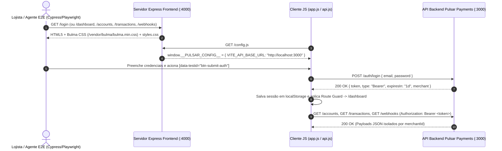

# Arquitetura e Integração Full-Stack

Esta página descreve a arquitetura da Aplicação Web **PulPay (`ppp-pulpay-frontend`)** e como ela se comunica de forma desacoplada com a API REST **Pulsar Payments (`ppp-pulpay-backend`)**.

---

## 1. Diagrama de Arquitetura e Fluxo de Requisições

---

## 2. Organização em Camadas

### 2.1 Camada Frontend (`ppp-pulpay-frontend` — Porta `4000`)
- **`src/server.js` & `src/app.js`:**
  - Servidor HTTP Express configurado na porta `4000` (com suporte Serverless para a Vercel via `api/index.js` e `vercel.json`).
  - Injeta headers de segurança HTTP (`X-Content-Type-Options: nosniff`, `X-Frame-Options: SAMEORIGIN`, `Referrer-Policy: strict-origin-when-cross-origin` e remoção de `X-Powered-By`).
  - Expõe o endpoint `/config.js` e `/api/config` para fornecer a variável de ambiente `VITE_API_BASE_URL` em tempo de execução sem URLs hardcoded nos módulos do cliente.
  - Expõe `/health` para monitoramento de disponibilidade da camada Web.
- **`public/js/api.js` (Cliente HTTP & Sessão JWT):**
  - Centraliza todas as chamadas `fetch` para a API Backend.
  - Injeta automaticamente o cabeçalho `Authorization: Bearer <token>` nas rotas protegidas (`/accounts`, `/transactions`, `/webhooks`).
  - Intercepta globalmente respostas `401 Unauthorized`, limpando o estado local e redirecionando para `/login`.
  - Converte qualquer falha HTTP fora da faixa `200-299` em instâncias determinísticas de `ApiError`, priorizando a propriedade `message` do contrato `{ error, message }`.
- **`public/js/formatters.js` (Padronização & Sanitização):**
  - Formatação monetária em Real Brasileiro (`Intl.NumberFormat('pt-BR', { style: 'currency', currency: 'BRL' })`).
  - Serialização numérica decimal com até 2 casas (`Number(parsed.toFixed(2))`).
  - Formatação temporal `dd/MM/yyyy HH:mm:ss` no fuso horário do usuário.
  - Máscara dinâmica para CPF (`000.000.000-00`) e CNPJ (`00.000.000/0000-00`).
  - Sanitização `escapeHtml` contra **DOM XSS**.
- **`public/js/app.js` (Controlador SPA & Módulos de Negócio):**
  - Gerencia Route Guards client-side, alternância de tema (Dark/Light), menu mobile flutuante, controle do player de vídeo da seção *"Quem Somos"* e os 4 domínios funcionais do Pulsar Payments.

### 2.2 Camada Backend (`ppp-pulpay-backend` — Porta `3000`)
- Arquitetura em camadas (**Routes → Controllers → Services → Models → Persistence JSON**):
  - **Auth (`/auth/register`, `/auth/login`):** Hashing de senha com `bcryptjs` (salt `10`) e emissão de JWT assinado.
  - **Accounts (`/accounts`, `/accounts/:id`):** Carteiras exclusivas em `BRL` com trava contra saldo inicial negativo.
  - **Transactions (`/transactions`, `/transactions/:id`, `/transactions/:id/refund`):** Motor de crédito/débito, controle de `Idempotency-Key` e máquina de estados de estorno.
  - **Webhooks (`/webhooks`, `/webhooks/test`):** Registro de endpoints, histórico de entregas (`deliveryLogs`) e assinatura criptográfica **HMAC SHA-256** (`X-Signature: sha256=<64_hex>`).
