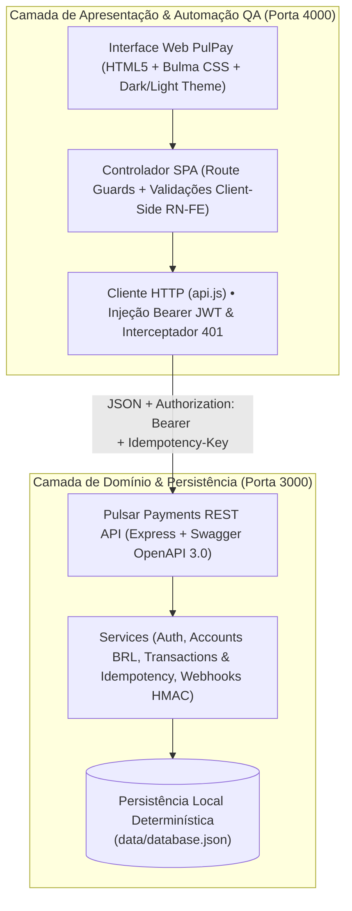

# Bem-vindo(a) à Wiki do PulPay (`pulsar payments`)

> **Projeto de Portfólio Pessoal - Turma 5** • **Mentoria 2.0 (Júlio de Lima)**  
> **Autor:** Dennys Matos (`By Dennys Matos`)

O **PulPay (`pulsar payments`)** é um ecossistema completo de **Hub de Pagamentos, Gestão de Carteiras em BRL, Conciliação de Transações com Idempotência e Simulador de Webhooks Assinados com HMAC SHA-256**, construído com finalidade didática e prática para exercitar Engenharia de Qualidade de Software e **Design for Testability (Padrão QA 2.0)**.

---

## Ecossistema de Repositórios

| Camada | Repositório | Porta Local | Tecnologias Principais |
| :--- | :--- | :---: | :--- |
| **Frontend Web (`ppp-pulpay-frontend`)** | `mts20t5-ppp-pulpay-frontend` | `4000` | Node.js, Express, HTML5 Semântico, Bulma CSS v1, Design Tokens (Dark/Light Mode), Fetch API |
| **Backend API (`ppp-pulpay-backend`)** | `mts20t5-ppp-pulpay-backend` | `3000` | Node.js, Express, JWT (`jsonwebtoken`), `bcryptjs`, `node:crypto` (HMAC SHA-256), OpenAPI 3.0 (`/api-docs`), Persistência JSON (`data/database.json`) |

---

## Navegação Rápida da Wiki

1. **[Arquitetura e Integração Full-Stack](Arquitetura-e-Integracao)**
   - Fluxo entre Navegador/Ferramenta E2E, Servidor Express Frontend (`:4000`) e API REST Backend (`:3000`), injeção de variáveis de ambiente (`VITE_API_BASE_URL`), headers de segurança OWASP e deploy Serverless na Vercel.
2. **[Regras de Negócio e Máquina de Estados (`RN-FE-01` a `RN-FE-12`)](Regras-de-Negocio-e-Contratos)**
   - Rastreabilidade completa entre requisitos funcionais (`RF01` a `RF04`), regras de negócio do frontend (`RN-FE-01` a `RN-FE-12`), regras financeiras do backend (`RN01` a `RN05`) e tabela de contratos de erro HTTP (`400`, `401`, `404`, `409`, `422`, `500`).
3. **[Guia de Testabilidade QA, Seletores `data-testid` e Heurísticas (Mentoria 2.0)](Guia-de-Testabilidade-QA-e-E2E)**
   - Catálogo completo de seletores resilientes `data-testid`, semântica de acessibilidade (`role="alert"`, `aria-live`), Particionamento de Equivalência, Análise de Valor Limite (BVA), Teste de Transição de Estados e Replay Idempotente.
4. **[Especificação de Casos de Teste (ISO/IEC/IEEE 29119-3)](Casos-de-Teste-ISO-29119-3)**
   - Catálogo com 14 Casos de Teste formais documentados no modelo tabelado da norma **ISO-29119-3** (ID, Título, Prioridade, Rastreabilidade, Pré-Condições, Passos/Ação/Resultados Esperados e Pós-Condições).
5. **[Relatório de Sessão (Test Charter - SBTM)](Relatorio-de-Sessao-Test-Charter)**
   - Relatórios de sessões de testes exploratórios baseados no artigo de Jon Bach sobre *Session-Based Test Management*, contendo Test Charter, Tamanho da Sessão, Notas de Informações `(I)` e Riscos `(R)`, Defeitos e Perguntas.
6. **[Gestão de Defeitos (ISO/IEC/IEEE 29119-3 & GitHub Issues)](Gestao-de-Defeitos-ISO-29119-3)**
   - Catálogo de defeitos estruturados segundo a norma **ISO-29119-3** (`DEF-01` a `DEF-04`) com vínculo direto às **[Issues #1 a #4 do GitHub](https://github.com/dennysmatos/mts20t5-ppp-pulpay-frontend/issues)**, Casos de Teste e Sessões Exploratórias.
7. **[Design System, Identidade Visual PulPay e UX](Design-System-e-Identidade-Visual)**
   - Brandbook oficial do **PulPay** (Azul Noturno, Roxo Cósmico, Azul Elétrico e Verde BRL), logotipo vetorial com onda de pulso, navbar fixa com *Glassmorphism*, *Floating Glass Mobile Drawer* e seção estática *"Quem Somos"* com vídeo demonstrativo em loop.
8. **[Instalação, Execução Local, Testes e Deploy](Instalacao-Execucao-e-Deploy)**
   - Passo a passo para rodar o ecossistema localmente, executar as suítes de testes automatizados (`> 96%` de cobertura) e publicar o conteúdo desta pasta `wiki/` na aba **Wiki** do GitHub.

---

## Visão Geral do Fluxo Operacional

