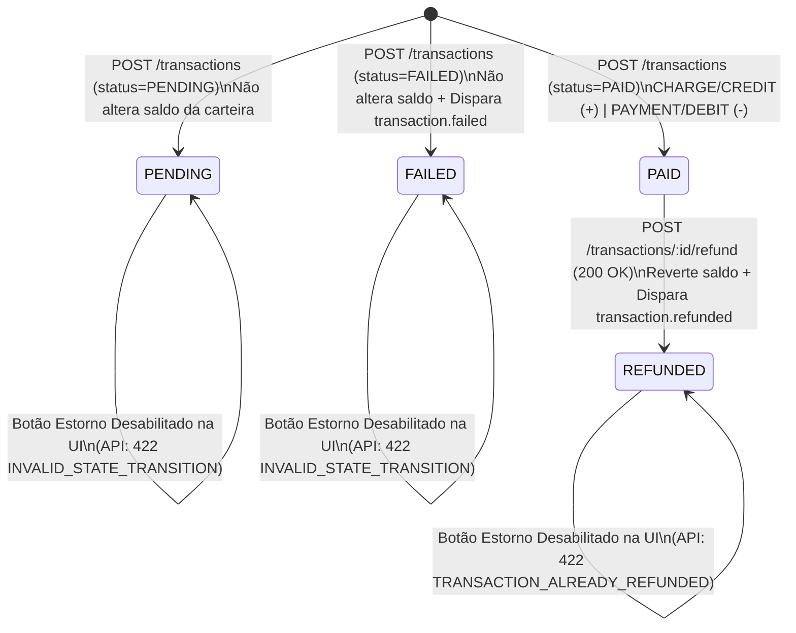

# Regras de Negócio e Máquina de Estados (`RN-FE-01` a `RN-FE-12`)

Esta página documenta todas as Regras de Negócio implementadas no Frontend Web (`RN-FE-01` a `RN-FE-12`) em consonância com as regras financeiras (`RN01` a `RN05`) e contratos OpenAPI 3.0 (`swagger.yaml`) do Backend.

---

## 1. Matriz de Rastreabilidade de Regras de Negócio

| Código | Módulo | Descrição da Regra e Comportamento na UI | Contrato da API Relacionado |
| :--- | :--- | :--- | :--- |
| **`RN&#8209;FE&#8209;01`** | Arquitetura & Segurança | Armazena `token` e `merchant` após login/registro; injeta `Authorization: Bearer <token>`; protege rotas privadas (`/dashboard`, `/accounts`, `/transactions`, `/webhooks` → `/login`); redireciona autenticados em `/login` ou `/register` para `/dashboard`; intercepta `401` limpando sessão e exibindo `"Sua sessão expirou ou é inválida. Faça login novamente."` | `POST /auth/login` `POST /auth/register` `401 UNAUTHORIZED` |
| **`RN&#8209;FE&#8209;02`** | Padronização Monetária e Temporal | Exibe valores em `BRL` (`R$ 1.250,50`) via `Intl.NumberFormat('pt-BR')`; envia valores para a API como `Number` decimal com até 2 casas (`1250.50`); exibe datas ISO-8601 em `dd/MM/yyyy HH:mm:ss`. | Todos os endpoints com `balance`, `initialBalance`, `amount` e timestamps |
| **`RN&#8209;FE&#8209;03`** | Tratamento Determinístico de Erros | Exibe prioritariamente a propriedade `message` retornada em `{ error, message }`; exibe alerta amigável em erro de rede ou `500`; desabilita botões com estado `is-loading` durante requisições. | `400`, `401`, `404`, `409`, `422`, `500` |
| **`RN&#8209;FE&#8209;04`** | Cadastro de Lojista (`/register`) | Valida `name` (trim), `email` (minúsculas e formato válido), `document` (máscara CPF/CNPJ opcional) e `password` (feedback imediato se `< 6` caracteres). Em `201 Created`, autentica e redireciona para `/dashboard`. Em `409 EMAIL_ALREADY_EXISTS`, destaca o campo de e-mail. | `POST /auth/register` (`201`, `400 WEAK_PASSWORD`, `409 EMAIL_ALREADY_EXISTS`) |
| **`RN&#8209;FE&#8209;05`** | Login de Lojista (`/login`) | Exige `email` e `password`. Em `200 OK`, salva sessão e redireciona para `/dashboard`. Em `401 INVALID_CREDENTIALS`, exibe `"Credenciais inválidas: e-mail ou senha incorretos"` mantendo o e-mail preenchido e limpando apenas a senha. | `POST /auth/login` (`200`, `400 VALIDATION_ERROR`, `401 INVALID_CREDENTIALS`) |
| **`RN&#8209;FE&#8209;06`** | Listagem de Carteiras (`/accounts`) | Apresenta cards com Nome (`name`), ID (`_id`), Moeda (`BRL`), Status (`ACTIVE` em verde / `BLOCKED` em vermelho) e Saldo Atual (`balance`). Exibe *Empty State* quando `total: 0`. | `GET /accounts` `GET /accounts/:id` |
| **`RN&#8209;FE&#8209;07`** | Criação de Carteira (`/accounts`) | Nome opcional (assume `"Conta Principal"`), moeda `BRL` padrão (permite `USD`/`EUR` para teste QA `422 UNSUPPORTED_CURRENCY`) e trava contra saldo inicial negativo (`422 NEGATIVE_BALANCE_NOT_ALLOWED`). Atualiza listagem e seletores após `201 Created`. | `POST /accounts` (`201`, `400 INVALID_BALANCE`, `422`) |
| **`RN&#8209;FE&#8209;08`** | Criação de Transação e Idempotência | Seleciona carteira (`BLOCKED` sinalizada), tipo (`CHARGE`/`CREDIT` ou `PAYMENT`/`DEBIT`), valor `> 0.00`, status inicial (`PAID`, `PENDING`, `FAILED`) e envia header `Idempotency-Key` (UUID automático ou manual para QA). Em `201 Created` (`idempotentReplayed: false`), atualiza `accountBalance` e exibe `webhookDeliveries`. Em `200 OK` (`idempotentReplayed: true`), exibe o banner de replay idempotente sem duplicar saldo. | `POST /transactions` (`201`, `200`, `400`, `404`, `422 INSUFFICIENT_FUNDS`) |
| **`RN&#8209;FE&#8209;09`** | Listagem e Filtros de Transações | Permite filtros combinados por `accountId`, `status` e `type`. Exibe entradas (`CHARGE`, `CREDIT`) como `+ R$ ...` em verde quando `PAID` e saídas (`PAYMENT`, `DEBIT`) como `- R$ ...` em laranja quando `PAID`, com badges distintos por status. | `GET /transactions?accountId=&status=&type=` |
| **`RN&#8209;FE&#8209;10`** | Estorno de Transação (`/refund`) | Habilita botão `"Solicitar Estorno"` exclusivamente para transações `PAID` (desabilitado com tooltip para `PENDING`, `FAILED` e `REFUNDED`). Abre modal de confirmação detalhando o impacto financeiro e campo opcional `reason`. | `POST /transactions/:id/refund` (`200`, `404`, `422`) |
| **`RN&#8209;FE&#8209;11`** | Cadastro e Logs de Webhooks | Valida URL iniciando com `http://` ou `https://` (`400 INVALID_WEBHOOK_URL`), checkboxes de eventos pré-selecionados, campo `secret` com mostrar/ocultar/copiar e expansão de `deliveryLogs` com cópia de assinatura `sha256=...`. | `POST /webhooks` `GET /webhooks` |
| **`RN&#8209;FE&#8209;12`** | Simulador de Disparo HMAC | Painel interativo para disparar `POST /webhooks/test` com `webhookId` opcional, `event` e JSON `data` customizado, exibindo `targetUrl`, `headers` (`X-Signature: sha256=<64_hex>` e `X-Pulsar-Event`) e `payload` formatado. | `POST /webhooks/test` (`200`, `404 WEBHOOK_NOT_FOUND`) |

---

## 2. Máquina de Estados da Transação e Impacto Financeiro

---

## 3. Catálogo de Contratos de Erro da API Exibidos no Frontend

Sempre que a API retorna um código fora da faixa `200-299`, o componente global `[data-testid="alert-error-message"]` (`role="alert"`) exibe o código do erro e a mensagem exata do contrato:

| Status HTTP | Código (`error`) | Mensagem Determinística (`message`) |
| :---: | :--- | :--- |
| `400` | `VALIDATION_ERROR` | `Os campos name, email e password são obrigatórios` / `Os campos email e password são obrigatórios para autenticação` |
| `400` | `WEAK_PASSWORD` | `A senha deve possuir no mínimo 6 caracteres` |
| `400` | `INVALID_BALANCE` | `O saldo inicial (initialBalance) deve ser um valor numérico válido` |
| `400` | `INVALID_WEBHOOK_URL` | `Informe uma URL válida (http:// ou https://) para o cadastro do webhook` |
| `401` | `INVALID_CREDENTIALS` | `Credenciais inválidas: e-mail ou senha incorretos` |
| `401` | `UNAUTHORIZED` | `Sua sessão expirou ou é inválida. Faça login novamente.` |
| `404` | `ACCOUNT_NOT_FOUND` | `Conta não encontrada para o lojista autenticado` |
| `404` | `TRANSACTION_NOT_FOUND` | `Transação não encontrada para o lojista autenticado` |
| `404` | `WEBHOOK_NOT_FOUND` | `Webhook não encontrado para o lojista autenticado` |
| `409` | `EMAIL_ALREADY_EXISTS` | `Já existe um lojista cadastrado com este e-mail` |
| `422` | `NEGATIVE_BALANCE_NOT_ALLOWED` | `Operação não permitida: o saldo da conta não pode ser negativo` |
| `422` | `UNSUPPORTED_CURRENCY` | `Moeda não suportada. O Pulsar Payments opera exclusivamente com BRL` |
| `422` | `INSUFFICIENT_FUNDS` | `Saldo insuficiente na conta para realizar esta operação (saldo não pode ficar negativo)` |
| `422` | `INVALID_TRANSACTION_AMOUNT` | `O valor da transação (amount) deve ser maior que zero` |
| `422` | `INVALID_INITIAL_STATUS` | `Não é permitido criar uma transação diretamente com o status REFUNDED. Utilize o endpoint de estorno (/refund)` |
| `422` | `ACCOUNT_BLOCKED` | `A conta selecionada está bloqueada para movimentações financeiras` |
| `422` | `INVALID_STATE_TRANSITION` | `Transição de estado inválida: não é permitido estornar uma transação com status PENDING. Apenas transações com status PAID podem ser estornadas.` |
| `422` | `TRANSACTION_ALREADY_REFUNDED` | `Transição de estado inválida: esta transação já se encontra com status REFUNDED` |
| `422` | `INSUFFICIENT_FUNDS_FOR_REFUND` | `Saldo insuficiente na conta para estornar esta cobrança sem negativar a carteira` |
